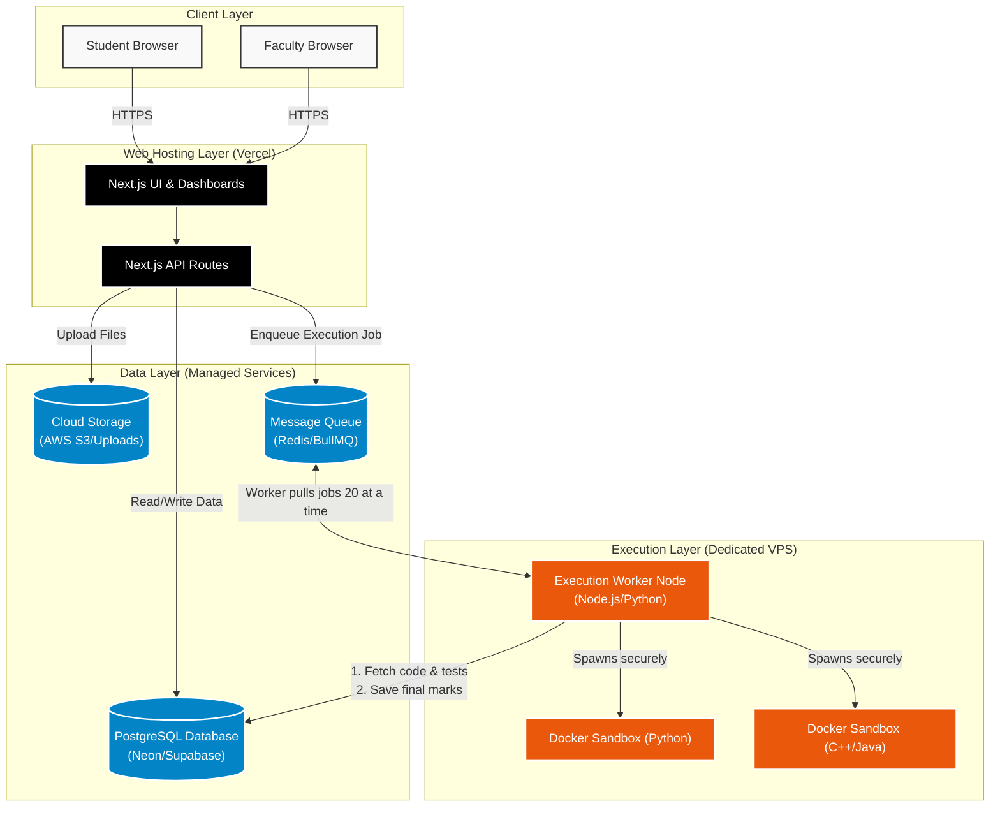
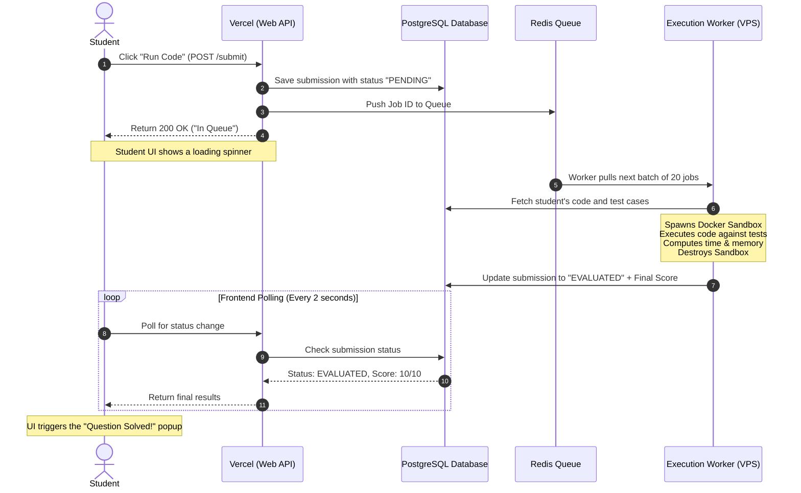

# DOCS System Architecture & Data Flow

## 1. System Architecture Diagram
This diagram illustrates the **Hybrid Approach**. It shows how the infrastructure is decoupled into three distinct layers: Web Hosting (Vercel), Data Storage (Managed Cloud), and Code Execution (Dedicated VPS).

***

## 2. Code Submission Data Flow (Sequence Diagram)
This diagram maps the exact step-by-step journey of a piece of code from the moment a student clicks "Submit" until they see their final score, demonstrating how the queue safely handles 500 concurrent users.

