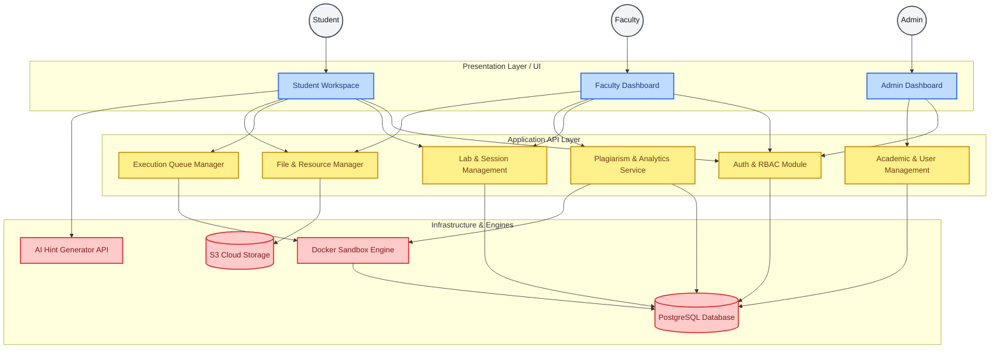
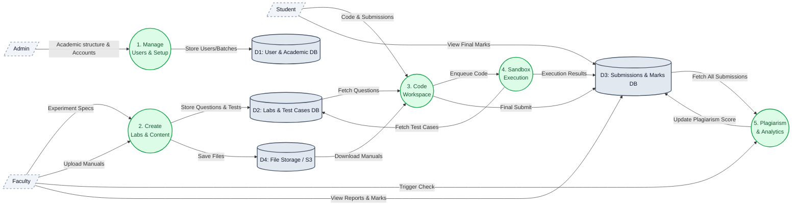

# Full Project System Architecture & Data Flow (DOCS)

## 1. Complete System Architecture Diagram
This diagram outlines all logical components, modules, and physical infrastructure layers comprising the entire DOCS platform.

***

## 2. Platform Data Flow Diagram (DFD Level 1)
This diagram maps the flow of data through the system's core processes, illustrating how data travels from Admin setup to Faculty content creation, into Student submissions, and finally through automated System evaluation.

